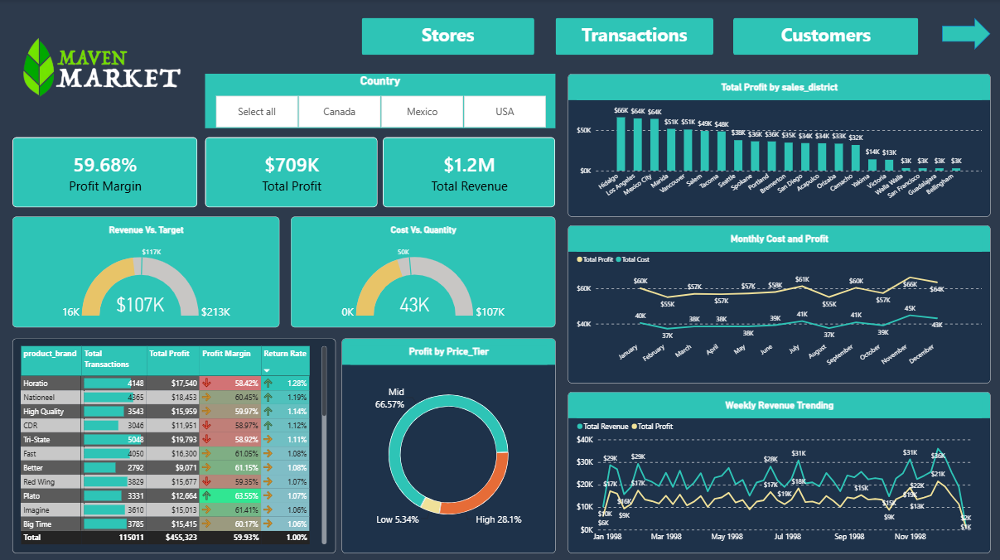
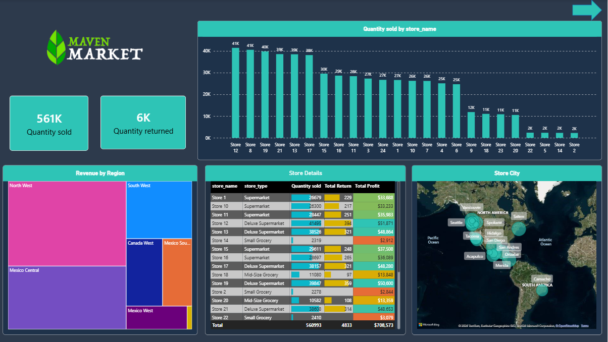
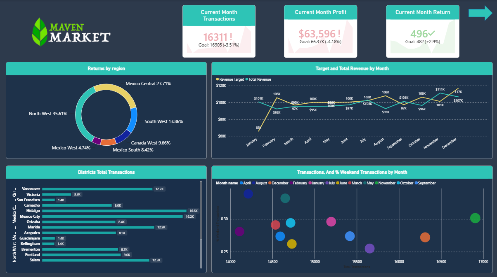
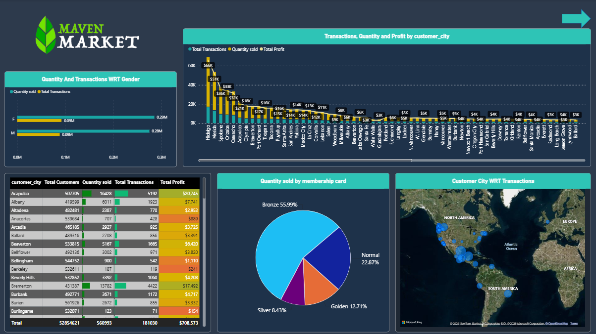

# Maven Market Sales Dashboard | Power BI

An interactive, 4-page sales dashboard built in Power BI to analyze revenue, profit, stores, returns, and customer behaviour for data-driven decision-making.

## Dashboard Preview

### 1. Topline Performance

### 2. Stores

### 3. Transactions & Returns

### 4. Customers

## Project Overview

This project transforms raw Maven Market sales data into a single, clean, multi-page dashboard. It helps management answer four key questions at a glance:

1. How much are we earning?
2. Which store and region is performing the best?
3. Where are returns coming from?
4. Who is our customer and what is he buying?

The dashboard is designed for executives and managers who need a quick, high-level summary without digging through spreadsheets.

## Key KPIs

| Metric | Value |
| :--- | :--- |
| Total Revenue | $1.2M |
| Total Profit | $709K |
| Profit Margin | 59.68% |
| Quantity Sold | 561K |
| Quantity Returned | 6K |
| Current Month Transactions | 16,311 |

## Key Insights

* **Highly Profitable:** The business is operating at a **59.68% profit margin** with $709K total profit on $1.2M revenue.
* **Mexico Central Leads:** **Mexico Central** is the top-performing region by revenue, followed by Mexico South and Canada West.
* **Mid Price Tier Drives Profit:** **Mid** price tier products contribute the highest share of profit, over 52% of total profit.
* **Returns Are Under Control:** Only **6K** units returned out of **561K** sold, but **South West** region has the highest return share at **17.58%**.
* **Bronze Members Dominate:** **Bronze** membership card customers account for **45.08%** of quantity sold, the largest customer segment.
* **Top City:** **Hidalgo** is the top city by transactions, quantity sold, and profit.
* **Revenue Target Missed:** Revenue is at $107K vs $125K target, while cost is under budget, showing cost control is strong but sales need a push.

## Dashboard Features

* **Topline Performance View:** All key KPIs, revenue vs target, cost vs budget, and profit by price tier on one screen
* **Stores View:** Quantity sold by store, revenue by region treemap, store details table, and store city map
* **Transactions & Returns View:** Current month transactions, profit and returns, returns by region, and monthly trend analysis
* **Customers View:** Top 10 customer cities, quantity and transactions by gender, membership card analysis, and customer map
* **Interactive Slicers:** Filter the entire dashboard by Country - Canada, Mexico, USA
* **Page Navigation:** One-click navigation buttons between Topline, Stores, Transactions, and Customers
* **Clean and Professional UI:** Designed for clarity and executive reporting, with teal theme

## Tools & Techniques

* **Power BI Desktop** - Dashboard building and visualization
* **DAX** - Custom measures for Total Profit, Total Revenue, Profit Margin, and Total Transactions
* **Data Modeling** - Cleaned tables and relationships for accurate reporting
* **Power Query** - Data cleaning and transformation
* **Top N Filtering** - Top 10 Cities analysis for clear customer insights

## Repository Structure

- 01-Topline-Performance.png - Dashboard screenshot
- 02-Stores.png - Dashboard screenshot
- 03-Transactions-Returns.png - Dashboard screenshot
- 04-Customers.png - Dashboard screenshot
- Maven-Market-Sales-Dashboard.pdf - Full dashboard in PDF
- Maven-Market-Sales-Dashboard.pbix - Main Power BI file
- MavenMarket_Calendar.csv - Dataset
- MavenMarket_Customers.csv - Dataset
- MavenMarket_Products.csv - Dataset
- MavenMarket_Regions.csv - Dataset
- MavenMarket_Returns_1997_1998.csv - Dataset
- MavenMarket_Stores.csv - Dataset
- MavenMarket_Transactions.csv - Dataset
- README.md - Project documentation

## How to Use This Project

1. Clone or download this repository
2. Open the `.pbix` file in Power BI Desktop
3. Use the slicers to filter by Country and explore the dashboard
4. Use the navigation buttons to move between the 4 pages
5. Open the `.pdf` file for a quick view without Power BI

## What I Learned

* How to convert raw sales data into a multi-page story
* How to create dynamic KPIs using DAX measures
* How to use Top N filter to avoid cluttered charts
* How to design a dashboard that is not just visually appealing, but also useful for decision-making

## Connect With Me

**Tahira | Aspiring Data Analyst**

* LinkedIn: www.linkedin.com/in/tahira-data-analyst
* GitHub: https://github.com/tahira-data-analyst

If you found this project helpful, please give it a ⭐
